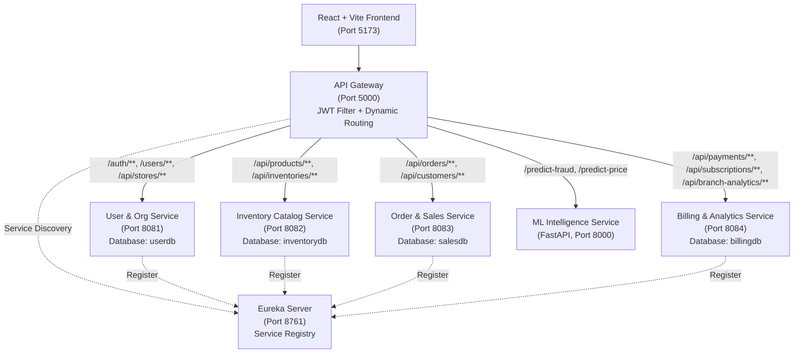

# Inventa POS

Inventa POS is a full-stack retail point-of-sale platform for multi-store operations. This repository contains a microservices-based Spring Boot backend, a React + Vite frontend, and a shared project knowledge base used to capture architecture decisions, role flows, analytics work, and operational fixes.

The platform is built around role-based workflows for super admins, store admins, branch managers, and cashiers. It covers onboarding, branch and employee management, catalog and inventory operations, checkout flows, refunds, shift reporting, analytics dashboards, exports, subscription plans, and payment-link based billing.

## Repository Layout

| Path | Purpose |
|---|---|
| `POS---Microservices` | Microservices backend architecture (Gateway, Eureka, and Domain Services) |
| `POS---System-frontend` | React 19 + Vite single-page application with role-based dashboards |
| `POS---ML` | Python FastAPI ML service: Fraud detection, Dynamic pricing, Demand forecasting (Port `8000`) |
| `brain` | Shared project notes, architecture audits, change history, and runbooks |

## Core Capabilities

- Multi-role access model with dedicated route trees and dashboards
- Store, branch, employee, category, and product management
- Inventory-aware retail operations and cashier checkout flows
- Returns, refunds, and shift-summary workflows
- Store-level and branch-level analytics dashboards
- Machine learning intelligence: Fraud prediction, dynamic pricing, and demand forecasting
- Subscription plans and upgrade flows
- Payment link integration with Razorpay and Stripe support

## Technology Stack

### Frontend
- React 19, Vite 7, React Router, Redux Toolkit, Tailwind CSS 4, Radix UI primitives, Recharts, Axios

### Backend Microservices
- Java 17, Spring Boot 3.4 / 3.5
- Spring Cloud 2024.0.0 (Eureka Server & Client, Spring Cloud Gateway)
- Spring Security with JWT & Gateway header forwarding
- Spring Data JPA, MySQL (dedicated database per microservice)
- Razorpay Java SDK, Stripe Java SDK
- Maven Multi-Module Reactor

### ML Intelligence Service
- Python 3.10+, FastAPI, Scikit-learn, Pandas, Joblib, Uvicorn

## Microservices System Architecture



## Microservices Endpoints Overview

| Service | Endpoints | Purpose |
|---------|-----------|---------|
| **User & Org Service** | `/auth/**`, `/users/**`, `/api/stores/**` | Authentication, user management, and store/branch hierarchy |
| **Inventory Catalog Service** | `/api/products/**`, `/api/inventories/**` | Product catalog, categories, and inventory tracking |
| **Order & Sales Service** | `/api/orders/**`, `/api/customers/**` | Checkout, order processing, and customer management |
| **Billing & Analytics Service**| `/api/payments/**`, `/api/subscriptions/**`, `/api/branch-analytics/**` | Payment links, SaaS subscriptions, and store reporting |
| **ML Intelligence Service** | `/predict-fraud`, `/predict-price`, `/predict-demand` | Fraud detection, dynamic pricing, and demand forecasting |

## API Gateway

All frontend API requests are routed through the API Gateway on port `5000`.
The gateway is responsible for:

- Centralized request routing
- JWT validation
- Forwarding authenticated user information to downstream services
- Service discovery through Eureka
- Hiding individual microservice ports from the frontend

The frontend therefore communicates primarily with the Gateway rather than directly with individual microservices.

## Running the Microservices Locally

### 1. Create MySQL Databases
```sql
CREATE DATABASE IF NOT EXISTS userdb;
CREATE DATABASE IF NOT EXISTS inventorydb;
CREATE DATABASE IF NOT EXISTS salesdb;
CREATE DATABASE IF NOT EXISTS billingdb;
```

### 2. Service Startup Order

Open separate terminals and start services in order from the `POS---Microservices` directory:

| Step | Service | Command | Port |
|---|---|---|---|
| 1 | Eureka Server | `.\mvnw.cmd spring-boot:run -pl eureka-server` | 8761 |
| 2 | API Gateway | `.\mvnw.cmd spring-boot:run -pl api-gateway` | 5000 |
| 3 | User & Org Service | `.\mvnw.cmd spring-boot:run -pl user-org-service` | 8081 |
| 4 | Inventory Service | `.\mvnw.cmd spring-boot:run -pl inventory-catalog-service` | 8082 |
| 5 | Order & Sales Service | `.\mvnw.cmd spring-boot:run -pl order-sales-service` | 8083 |
| 6 | Billing & Analytics | `.\mvnw.cmd spring-boot:run -pl billing-analytics-service` | 8084 |
| 7 | ML Service *(optional)* | `uvicorn app:app --port 8000` (in `POS---ML`) | 8000 |
| 8 | Frontend | `npm run dev` (in `POS---System-frontend`) | 5173 |

## Frontend Architecture

The frontend is a role-driven single-page application.

- Session restoration and role routing are centralized in `src/App.jsx`
- State is managed through Redux Toolkit in `src/Redux Toolkit/globleState.js`
- Role-specific routes are defined in `src/routes`
- Major UI surfaces live under `src/pages/store`, `src/pages/Branch Manager`, `src/pages/cashier`, `src/pages/SuperAdminDashboard`, and `src/pages/common`

### Frontend data flow

1. User authenticates and receives a JWT
2. JWT is persisted in `localStorage`
3. App startup restores the session and fetches the current user profile
4. Role-based routes are selected centrally
5. Pages dispatch async thunks to call backend APIs
6. Redux slices store UI state for dashboards and workflows

## Running the Frontend Locally

### Prerequisites

- Node.js (version supported by Vite 7)
- npm
- Python 3.10+ (for the ML service)
- Java 17
- Maven Wrapper (included in `POS---Microservices`)
- MySQL 8+

### Backend setup

Create the four databases listed above, set `JWT_SECRET`, `DB_USERNAME`, and `DB_PASSWORD` in the environment, then start the services from `POS---Microservices` in the order shown in the startup table. Service-specific payment and AI integrations also require their corresponding credentials; see the service `application.yml` files and the root `.env.example` for variable names.

On Windows, `POS---Microservices/start-services.ps1` can launch the backend services in separate PowerShell windows after `JWT_SECRET` is set. The script expects the MySQL server and databases to be available first.

The microservices API gateway listens on `http://localhost:5000`.

### Frontend Setup

From `POS---System-frontend`:

```powershell
npm install
npm run dev
```

The frontend runs on `http://localhost:5173`.

During local development, Vite proxies API traffic to `http://localhost:5000` through [`POS---System-frontend/vite.config.js`](D:/Projects/Inventa-POS/POS---System-frontend/vite.config.js).

### Docker and hosted URL configuration

The Docker images use Docker DNS names for service-to-service calls, while direct local runs keep their `localhost` defaults. Override these values at container runtime when the network or service names differ:

| Variable | Used by | Default for direct local runs | Docker image default / hosted value |
|---|---|---|---|
| `EUREKA_URL` | Java Eureka clients | `http://localhost:8761/eureka/` | `http://eureka-server:8761/eureka/` |
| `EUREKA_INSTANCE_HOSTNAME` | Eureka server and ML registration | `localhost` | `eureka-server` in Eureka; `ml-intelligence-service` in ML |
| `EUREKA_SERVER` | ML Eureka client | `http://localhost:8761/eureka/` | `http://eureka-server:8761/eureka/` |
| `ORDER_SALES_SERVICE_URL` | Billing analytics | `http://localhost:8083` | `http://order-sales-service:8083` |
| `INVENTORY_SERVICE_URL` | Billing analytics | `http://localhost:8082` | `http://inventory-catalog-service:8082` |
| `USER_ORG_SERVICE_URL` | Billing analytics | `http://localhost:8081` | `http://user-org-service:8081` |
| `FRONTEND_BASE_URL` | Password-reset and payment return links | `http://localhost:5173` | Set to the public/browser-reachable frontend origin |
| `CORS_ALLOWED_ORIGINS` | API Gateway | `http://localhost:5173,http://localhost:3000` | Set to comma-separated, exact browser origins |
| `VITE_API_BASE_URL` | Frontend build | `http://localhost:5000` | Set at build time to the browser-reachable gateway URL |

The browser cannot resolve Docker-only names such as `api-gateway`; use the public gateway URL or a browser-facing same-origin proxy for `VITE_API_BASE_URL`. Set `FRONTEND_BASE_URL` without a trailing slash. Keep the comma-separated CORS list limited to the frontend origins you serve. These URL settings contain no credentials; sensitive credentials remain separate environment values.

### Run the complete stack with Docker Compose

The root `docker-compose.yml` builds and runs MySQL, Eureka, the API Gateway, the four domain services, the ML API, the frontend, Prometheus, and Grafana on one private Compose network. For local access, the published URLs are the frontend (`http://localhost:5173`), API Gateway (`http://localhost:5000`), Prometheus (`http://localhost:9090`), and Grafana (`http://localhost:3000`). MySQL, Eureka, the individual domain services, and the ML API are reachable only by containers on that network.

Create a private environment file from the checked-in template and replace its placeholders before starting the stack:

```powershell
Copy-Item .env.example .env
# Edit .env and set the required values; never commit this file.
docker compose up --build -d
docker compose ps
```

Required values are `MYSQL_ROOT_PASSWORD`, `DB_PASSWORD`, `JWT_SECRET`, `MAIL_USERNAME`, `MAIL_PASSWORD`, `RAZORPAY_API_KEY`, `RAZORPAY_API_SECRET`, and `GRAFANA_ADMIN_PASSWORD`. Use Razorpay **test-mode** credentials for local demonstration. `STRIPE_API_KEY` and `GEMINI_API_KEY` are optional and may remain blank. `FRONTEND_BASE_URL` and `CORS_ALLOWED_ORIGINS` should match the browser-visible frontend origin(s). `VITE_API_BASE_URL` is baked into the frontend during the image build; use the public/browser-reachable Gateway URL for hosted deployments, never a Docker-only service name.

Compose creates the four schemas on first initialization and grants the `inventa_app` database user access to those schemas. MySQL data persists in the named volume `inventa_mysql_data`; initialization scripts run only when that volume is empty. Keep the volume when stopping or updating the stack. The MySQL and Java services wait for their database/Eureka prerequisites to become healthy; downstream services and the Gateway also wait for the services they call. User/Org health includes its configured SMTP check, so valid Gmail SMTP app credentials and network access are needed for it to become healthy. Actuator checks use each service's existing `/actuator/health` endpoint.

Prometheus keeps its existing data volume and dashboard configuration, and scrapes services through Compose DNS. Grafana keeps its existing data and provisioning mounts. Do not use `docker compose down -v` for routine stops because it removes named volumes.

### Build commands

#### Frontend

```powershell
cd POS---System-frontend
npm run build
npm run test
```

#### Backend microservices

```powershell
cd POS---Microservices
./mvnw.cmd -DskipTests package
```

## Important Project Notes

- The frontend, microservices backend, and ML service are separate apps inside this repository
- JWT-based authentication is used across protected app routes and API endpoints
- Some project notes call out contract-drift risks between frontend thunks and backend endpoints, so integration validation remains important when extending flows
- Payment and subscription flows rely on external providers and should be tested with environment-specific credentials

## Knowledge Base

The shared [`brain`](D:/Projects/Inventa-POS/brain) directory is the repository's running knowledge base. It includes:

- architecture and role audits
- analytics and export implementation notes
- historical seed runbooks
- bug-fix sweeps and change tracking

Useful starting documents (some older notes describe the former monolith and are retained as project history):

- [`brain/001-workspace-overview.md`](D:/Projects/Inventa-POS/brain/001-workspace-overview.md)
- [`brain/015-role-features-superadmin-storeadmin-branchmanager-cashier-apr-23.md`](D:/Projects/Inventa-POS/brain/015-role-features-superadmin-storeadmin-branchmanager-cashier-apr-23.md)
- [`brain/CHANGELOG.md`](D:/Projects/Inventa-POS/brain/CHANGELOG.md)

## License

No license is currently declared in this repository.
